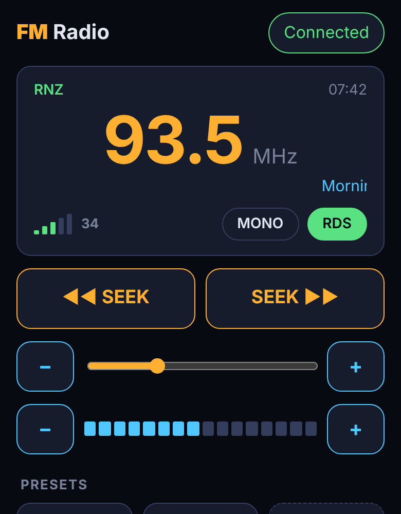

# CYD FM Radio

A touch-screen FM radio built from an ESP32 "Cheap Yellow Display" (ESP32-2432S028R, 2.8" 320×240) and an RDA5807M FM tuner module. It also includes a phone control page that connects over Bluetooth LE from Chrome on Android.

I built it to feed local FM stations into a Japanese-import car stereo through its 3.5 mm AUX input. The car radio only tunes 76–90 MHz.

## Features

- **Main screen:**
  - big frequency readout and band scale
  - signal-strength bars
  - volume bar
  - seek buttons
  - STEREO/MONO and RDS switches
  - RDS station name, scrolling radio text and clock
- **Settings screen** (gear icon), with changes applied live:
  - seek threshold
  - antenna input and LNA current
  - new demodulation method
  - soft blend and its threshold
  - soft mute
  - bass boost
  - de-emphasis (75/50 µs)
  - RDS filter (BASIC / STRICT)
  - Bluetooth on/off
- **Phone control (BLE):**
  - live status
  - seek and fine tuning
  - volume
  - 6 presets
  - all settings
- **Remembers your setup:** station, volume, settings and presets are saved in EEPROM.
- **Protection against I2C glitches:** a failed I2C read can no longer send the tuner off-band (to 189.3 MHz).

## Hardware

| Part | Notes |
|---|---|
| ESP32-2432S028R ("CYD") | ILI9341 display + XPT2046 resistive touch |
| RDA5807M module | I2C, with 3.5 mm audio jack |

### Wiring

| RDA5807M module | CYD |
|---|---|
| SDA | IO27 |
| SCL | IO18 |
| VCC | 3.3V |
| GND | GND |

IO27 and IO18 are on the 4-pin connector labelled `SPI` (IO23/IO19/IO18/IO27). If you see I2C errors, add 4.7 kΩ pull-up resistors from SDA and SCL to 3.3 V.

The touch controller uses its own pins (CLK 25, MOSI 32, MISO 39, CS 33, IRQ 36). The sketch sets these up.

### Antenna

On most of these jack modules, the earphone cable is the antenna. In a car, the AUX cable's ground ties that antenna to the car body, so reception suffers.

For better reception, connect a ~75 cm wire, or the car's antenna through a splitter, to **pin 2 (FMIN)** of the RDA5807M through a 100 pF capacitor. See [docs/antenna_wiring.png](docs/antenna_wiring.png). Then try the **Antenna input** setting while watching the RSSI number.

### Audio tip

If the voice sounds quieter than the music, as if someone is talking in the background, the audio ground between the module and the AUX input is poor. Switch to **MONO**, or add a solid ground wire between the CYD's GND and the sleeve of the AUX plug.

## Building the firmware

Use the Arduino IDE with the **esp32** board package and the board **ESP32 Dev Module**.

Libraries (install from the Library Manager):

- **TFT_eSPI**: set `User_Setup.h` up for the CYD (ILI9341 driver; MISO 12, MOSI 13, SCLK 14, CS 15, DC 2, backlight 21). Fonts 1, 2, 4 and 7 must be enabled.
- **XPT2046_Touchscreen**
- **PU2CLR RDA5807**
- **NimBLE-Arduino** 2.x: only needed when `ENABLE_BLE` is `1`

If the sketch is too big, choose **Tools → Partition Scheme → Huge APP (3MB No OTA)**.

Options at the top of `RadioTunerWithCYD.ino`:

| Define | Purpose |
|---|---|
| `ENABLE_BLE` | `0` builds without Bluetooth |
| `TOUCH_DEBUG` | `1` prints raw touch values to the Serial Monitor, for calibration |
| `TOUCH_X_MIN`, `TOUCH_X_MAX`, `TOUCH_Y_MIN`, `TOUCH_Y_MAX` | Touch calibration |

## Phone control page

The `phone/` folder is a static web app that uses **Web Bluetooth**. It works in Chrome on Android, but not on iPhone.

1. Host the `phone/` folder on any HTTPS site, for example GitHub Pages or Netlify Drop. Web Bluetooth needs HTTPS.
2. On the phone, open it in Chrome, then **⋮ → Add to Home screen**. It works offline after the first visit.
3. Tap **Connect** and pick **CYD Radio**.

### BLE protocol

| Characteristic | UUID | Use |
|---|---|---|
| Service | `6e5a0001-3c1d-4f7a-9b2e-7c2d9f1a0c01` | |
| State | `6e5a0002-…` | Read/notify: JSON status |
| Command | `6e5a0003-…` | Write: text command |

Commands:

| Command | Action |
|---|---|
| `S+` / `S-` | Seek up / down |
| `V+` / `V-` / `V=n` | Volume up / down / set to n |
| `T=9340` | Tune (frequency in 10 kHz units) |
| `ST=0/1` | Mono / stereo |
| `RDS=0/1` | RDS off / on |
| `P=n` | Tune to preset n |
| `PS=n` | Save current station to preset n |
| `PC=n` | Clear preset n |
| `C=index,value` | Change a setting |
